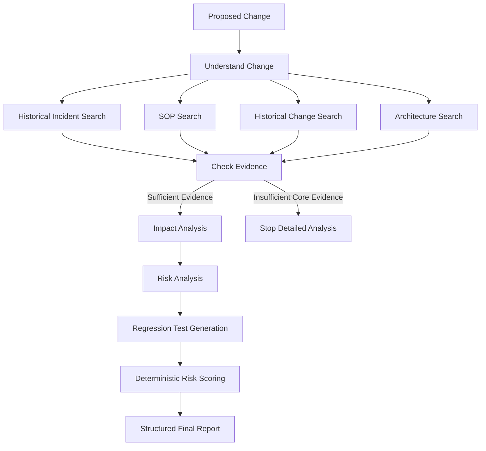

# ⚡ AI Change Analyzer

AI Change Analyzer is an AI-assisted production change risk analysis system built with **Python, LangGraph, Gemini, ChromaDB, Pydantic, Streamlit, and deterministic risk scoring**.

The system analyzes a proposed production change against historical enterprise knowledge and produces an evidence-backed **change risk report before production deployment**.

Unlike a traditional RAG chatbot, this project uses a multi-stage LangGraph workflow with:

- shared graph state
- parallel evidence retrieval
- conditional routing
- structured LLM outputs
- evidence-backed impact analysis
- historical risk analysis
- regression-test generation
- deterministic risk scoring
- structured final reporting

---

## Business Problem

Before implementing a production change, QA, Change Management, Operations, and engineering teams may need to understand:

- What functionality is changing?
- Which systems or components may be affected?
- What does the existing SOP require?
- Have similar changes caused incidents before?
- Which historical incidents are relevant?
- What regression scenarios should be tested?
- Could data integrity be affected?
- Are downstream systems involved?
- Is rollback or recovery sufficiently defined?

In real organizations, this information may be distributed across systems such as:

- ServiceNow change tickets
- historical incidents
- Confluence documentation
- SOP documents
- architecture documentation
- previous change records
- solution documentation

AI Change Analyzer demonstrates how these sources can be combined into an evidence-driven workflow.

---

## Example Change

The included reference change modifies card-production database retry behavior:

```text
Modify card-production database retry logic.

When a database deadlock occurs during batch processing,
automatically retry the failed database operation up to three times.
```

The analyzer attempts to determine:

```text
What could be affected?
        ↓
What has failed historically?
        ↓
What does the SOP require?
        ↓
What risks could this change introduce?
        ↓
What should QA test?
        ↓
How risky is the change overall?
```

---

## Architecture



The four retrieval branches are independent and execute in parallel before LangGraph merges them at the evidence-check stage.

---

## LangGraph Workflow

```text
START
  ↓
Understand Change
  ↓
┌─────────────────────────────────────────────┐
↓                 ↓               ↓           ↓
Incidents         SOP           Changes   Architecture
└──────────────────────┬──────────────────────┘
                       ↓
                 Check Evidence
                   ↙       ↘
          insufficient    sufficient
                ↓              ↓
               END       Impact Analysis
                              ↓
                         Risk Analysis
                              ↓
                      Regression Tests
                              ↓
                    Deterministic Score
                              ↓
                         Final Report
                              ↓
                             END
```

Historical incidents and previous changes are useful supporting evidence, but the workflow can continue if one or both are unavailable.

If **both SOP and architecture evidence are unavailable**, the workflow stops detailed technical reasoning rather than generating unsupported conclusions.

---

## Why LangGraph?

This problem is not a single question-answer operation.

Different information becomes available at different stages, and the workflow needs explicit control over what happens next.

LangGraph provides:

- shared workflow state
- explicit processing nodes
- execution edges
- parallel branches
- branch synchronization
- conditional routing

For example, incident retrieval does not depend on SOP retrieval.

Therefore these searches can execute independently:

```text
                Understand Change
                       ↓
       ┌───────────────┼───────────────┐
       ↓               ↓               ↓
   Incidents          SOP         Architecture
       │               │               │
       └───────────────┼───────────────┘
                       ↓
                    Merge
```

This is more appropriate than forcing the entire process into one large LLM prompt.

---

## LangGraph State

Each workflow execution uses a shared `ChangeAnalysisState`.

The state grows as nodes complete their responsibilities:

```text
original_change
      ↓
change_summary
affected_components
search_queries
      ↓
related_incidents
related_changes
retrieved_sop
architecture_evidence
      ↓
evidence_status
missing_information
      ↓
impact_findings
      ↓
identified_risks
      ↓
recommended_tests
      ↓
risk_score
overall_risk
risk_breakdown
      ↓
final_report
```

A node reads the fields it needs and returns only its partial state update.

Example:

```python
return {
    "change_summary": result.change_summary,
    "affected_components": result.affected_components,
}
```

The project uses a `TypedDict` for lightweight LangGraph state and Pydantic models for validated structured LLM outputs.

---

## Workflow Nodes

The graph contains the following major nodes:

```text
understand_change

retrieve_incidents
retrieve_sop
retrieve_similar_changes
retrieve_architecture

check_evidence
handle_insufficient_evidence

analyze_impact
assess_risk
generate_tests

score_risk
generate_final_report
```

Not every node uses an LLM.

That is deliberate.

---

## AI vs Deterministic Processing

### LLM-powered tasks

Gemini is used where language understanding or reasoning adds value:

```text
Understand an unstructured change

Generate source-specific retrieval queries

Analyze technical impact from evidence

Identify evidence-backed risks

Generate regression-test scenarios
```

### Deterministic tasks

Normal Python and supporting libraries are used where deterministic behavior is more appropriate:

```text
Excel ingestion

PDF extraction

Structure-aware chunking

Vector retrieval

Evidence availability checks

Conditional routing

Risk scoring

Final risk classification

Final report assembly
```

This keeps the LLM focused on reasoning rather than using it for tasks that conventional code can perform more reliably.

---

## Structured LLM Output

Pydantic models constrain LLM responses into predictable structures.

The project includes models such as:

```text
ChangeUnderstanding
ImpactAnalysis
RiskAnalysis
TestRecommendations
FinalChangeReport
```

Instead of depending on unpredictable free-form output, downstream nodes receive structured fields such as:

```text
title
description
evidence
reasoning
severity
missing_information
```

This improves reliability and makes later processing easier to validate.

---

## Knowledge Sources

The project contains synthetic enterprise data representing realistic production-support knowledge.

```text
data/
├── changes/
│   ├── changes.xlsx
│   └── new_change.json
├── incidents/
│   └── incidents.xlsx
├── sop/
│   ├── card_production_sop.pdf
│   └── change_management_sop.pdf
└── product/
    └── card_production_solution.pdf
```

`new_change.json` is the proposed change being analyzed.

It is intentionally **not indexed as historical evidence**.

---

## Ingestion

The ingestion pipeline converts enterprise knowledge into LangChain `Document` objects.

```text
Excel Changes ──────┐
                    │
Excel Incidents ────┤
                    ├──→ LangChain Documents
SOP PDFs ───────────┤
                    │
Architecture PDF ───┘
```

Each document contains:

```text
page_content
metadata
```

Example incident metadata:

```python
{
    "source_type": "incident",
    "incident_id": "INC002",
    "application": "Card Production",
    "severity": "HIGH",
}
```

Metadata is used later to filter retrieval by source type.

---

## Structure-Aware Chunking

The project deliberately avoids blindly splitting all knowledge using fixed character counts.

Historical records are already meaningful business units:

```text
1 historical change   = 1 chunk
1 historical incident = 1 chunk
```

SOP and product documents contain explicit sections.

For example:

```text
Section 4: Database Failure Handling
→ one semantic chunk

Section 5: Partial Processing
→ one semantic chunk

Section 6: Duplicate Prevention
→ one semantic chunk
```

This preserves business meaning during retrieval and reduces the chance of separating a rule from its surrounding context.

---

## Vector Retrieval

Knowledge is embedded using:

```text
models/gemini-embedding-001
```

and stored in a persistent Chroma collection.

Documents are categorized using metadata:

```text
source_type = incident
source_type = change
source_type = sop
source_type = product
```

This allows the workflow to perform separate searches against one shared knowledge base.

Example:

```text
Incident query
    ↓
source_type = incident

SOP query
    ↓
source_type = sop
```

The Chroma index is persisted locally under `chroma_db/`.

That directory is intentionally excluded from Git because it can be recreated from the committed source data.

---

## Evidence, Inference, and Unknowns

A key design principle is separating three concepts.

### Evidence

Information retrieved from enterprise knowledge.

Example:

```text
INC002:
Retry caused duplicate card records.
```

### Inference

Reasoning derived from the supplied evidence.

Example:

```text
Automatic retries may introduce duplicate-processing risk
if commit state is not verified.
```

### Missing information

Information that cannot be confirmed from the proposed change or retrieved evidence.

Example:

```text
The change does not explain whether retry execution
contains idempotency controls.
```

The workflow is instructed to report unknowns rather than silently inventing missing technical details.

---

## Historical Incident Analysis

The synthetic historical incident dataset contains scenarios involving:

- database deadlocks
- partial batch completion
- duplicate processing
- missing notifications
- failed rollback
- duplicate files
- retry-related failures
- downstream failures
- inconsistent batch states

Example:

```text
INC002

Retry caused duplicate card records.

Root cause:
Retry logic did not verify whether the original transaction
had already committed.
```

These historical failures become evidence for proactive risk analysis of new changes.

---

## Deterministic Risk Scoring

The LLM does **not** directly choose the final LOW, MEDIUM, or HIGH change rating.

Instead, Python calculates a 100-point score.

| Risk factor | Maximum |
|---|---:|
| Application criticality | 15 |
| Affected scope | 10 |
| Historical incidents | 20 |
| Rollback quality | 15 |
| Test coverage gaps | 15 |
| Data-integrity exposure | 15 |
| Downstream dependencies | 10 |
| **Total** | **100** |

Classification thresholds:

```text
0–29   → LOW
30–59  → MEDIUM
60–100 → HIGH
```

The scoring policy is therefore explicit, auditable, and reproducible for the same graph state.

The overall end-to-end score can still vary slightly between runs because some inputs to the deterministic scorer—such as identified impacts and risks—are produced by the LLM.

---

## Current Reference Result

A recent execution of the included `CHG006` reference change produced:

```text
Overall Risk: HIGH
Risk Score:   89 / 100
```

Breakdown:

```text
Application criticality       15 / 15
Affected scope                 7 / 10
Historical incidents          16 / 20
Rollback quality              15 / 15
Test coverage gaps            11 / 15
Data integrity exposure       15 / 15
Downstream dependencies       10 / 10
```

The exact LLM-generated findings may vary between executions, while the scoring rules themselves remain deterministic.

---

## Example Risks

The reference scenario may identify risks such as:

- duplicate card records caused by unsafe retries
- duplicate output files or downstream notifications
- partial commits or inconsistent batch states
- insufficient recovery controls
- retry-related operational failures

The report connects these risks back to retrieved historical incidents, SOP requirements, impact findings, or previous changes.

---

## Regression-Test Generation

The workflow converts identified risks into focused test scenarios.

Examples include:

```text
Deadlock retry with pre-retry state verification

Duplicate prevention after partial processing

Maximum retry limit exceeded

Rollback and recovery validation

Downstream notification idempotency

Successful recovery after retry
```

Each generated test contains:

```text
title
scenario
expected_result
related_risks
```

---

## Streamlit UI

The project includes a Streamlit interface for demonstration.

The UI supports:

```text
Use included sample change

or

Upload another JSON change
```

It displays:

- change summary
- overall risk
- deterministic score
- affected components
- related historical incidents
- identified risks
- supporting evidence
- reasoning
- regression tests
- missing information
- score breakdown
- deployment recommendation

The compiled LangGraph is cached as a Streamlit resource, while each graph invocation still receives its own independent state.

The analysis result is stored in `st.session_state` so UI interactions do not unnecessarily repeat Gemini requests.

---

## Technology Stack

```text
Python 3.13
uv

LangGraph
LangChain Core
LangChain Chroma
LangChain Google GenAI

Gemini
Gemini Embeddings

ChromaDB
Pydantic

Pandas
OpenPyXL
PyPDF

Streamlit

pytest
Ruff
```

---

## Project Structure

```text
ai-change-analyzer/
│
├── data/
│   ├── changes/
│   ├── incidents/
│   ├── sop/
│   └── product/
│
├── src/
│   └── ai_change_analyzer/
│       │
│       ├── ingestion/
│       │   ├── excel_loader.py
│       │   ├── pdf_loader.py
│       │   ├── section_chunker.py
│       │   ├── pipeline.py
│       │   └── indexer.py
│       │
│       ├── retrieval/
│       │   ├── embeddings.py
│       │   ├── vector_store.py
│       │   └── retriever.py
│       │
│       ├── graph/
│       │   ├── state.py
│       │   ├── nodes.py
│       │   └── workflow.py
│       │
│       ├── models/
│       │   ├── change_understanding.py
│       │   ├── impact.py
│       │   ├── risk.py
│       │   ├── recommendation.py
│       │   └── final_report.py
│       │
│       ├── scoring/
│       │   └── risk_scorer.py
│       │
│       ├── evaluation/
│       │   └── reference_case.py
│       │
│       ├── main.py
│       └── ui.py
│
├── tests/
│
├── .gitignore
├── .python-version
├── pyproject.toml
├── uv.lock
└── README.md
```

Generated local directories such as `.venv/`, `chroma_db/`, `.pytest_cache/`, `.ruff_cache/`, and the secret `.env` file are excluded from Git.

---

## Setup

### 1. Clone the repository

```bash
git clone <repository-url>
cd ai-change-analyzer
```

### 2. Install dependencies

```bash
uv sync
```

### 3. Configure Gemini

Create a local `.env` file:

```text
GOOGLE_API_KEY=your_api_key
```

Never commit this file.

---

## Build the Vector Index

Before running the analyzer for the first time:

```bash
uv run python -m ai_change_analyzer.ingestion.indexer
```

The reference dataset currently produces:

```text
Indexed 43 documents.
```

Subsequent runs detect the existing collection and avoid rebuilding it unnecessarily.

---

## Run the CLI

Using the included sample change:

```bash
uv run ai-change-analyzer
```

Equivalent module command:

```bash
uv run python -m ai_change_analyzer.main
```

Analyze another JSON change:

```bash
uv run ai-change-analyzer path/to/change.json
```

---

## Run the Streamlit UI

```bash
uv run streamlit run src/ai_change_analyzer/ui.py
```

Streamlit normally starts at:

```text
http://localhost:8501
```

---

## Run Tests

```bash
uv run pytest -q
```

Current deterministic suite:

```text
12 passed
```

These tests do not require live Gemini requests.

Run Ruff:

```bash
uv run ruff check .
```

---

## Evaluation Strategy

The project uses two evaluation layers.

### Deterministic tests

The automated suite covers areas such as:

```text
Excel ingestion

PDF ingestion

Structure-aware chunking

Knowledge pipeline

Graph state

Evidence routing

Risk scoring
```

These tests are fast and do not depend on probabilistic LLM wording.

### End-to-End Reference Evaluation

The reference evaluation executes the real LangGraph workflow, including Gemini.

Run:

```bash
uv run python -m ai_change_analyzer.evaluation.reference_case
```

The evaluation checks stable business properties rather than exact generated wording:

```text
Overall risk is HIGH

Risk score is at least 60

At least one risk is identified

Regression tests are generated

Missing information is identified

Historical incidents are retrieved

Generated risk evidence does not fabricate incident IDs
```

A previous reference execution produced:

```text
7 / 7 checks passed
REFERENCE CASE: PASS
```

Because this evaluation calls Gemini, it is intentionally kept separate from the deterministic pytest suite.

---

## Why This Is Not Just Another RAG Chatbot

A basic RAG application often looks like:

```text
Question
   ↓
Retrieve Documents
   ↓
LLM
   ↓
Answer
```

AI Change Analyzer performs a broader decision workflow:

```text
Proposed Change
      ↓
Understand Change
      ↓
Generate Evidence Queries
      ↓
Parallel Multi-Source Retrieval
      ↓
Evidence Validation
      ↓
Conditional Routing
      ↓
Impact Reasoning
      ↓
Historical Risk Analysis
      ↓
Regression-Test Generation
      ↓
Deterministic Risk Calculation
      ↓
Structured Decision Report
```

RAG is one component of the architecture.

LangGraph orchestrates the full process.

---

## Why Not One Giant Prompt?

One large prompt would mix responsibilities such as:

```text
Change understanding
Retrieval
Historical analysis
Architecture analysis
SOP interpretation
Risk identification
Test generation
Risk classification
```

That would make the system more difficult to:

- debug
- evaluate
- control
- audit
- improve independently

Separating responsibilities into graph nodes makes each stage easier to reason about and test.

---

## Why Not Use an LLM Everywhere?

Agentic or orchestrated AI does not mean every operation should use an LLM.

For example:

```text
Read Excel            → Python / Pandas

Parse PDF             → PyPDF

Vector retrieval      → ChromaDB

Check evidence        → Python

Calculate risk score  → Python

Understand change     → Gemini

Reason about impact   → Gemini
```

The architecture uses the simplest reliable mechanism for each responsibility.

---

## Conditional Routing

Before detailed analysis, the graph checks whether enough core enterprise evidence is available.

Example:

```text
SOP evidence          = none
Architecture evidence = none
        ↓
Evidence status = insufficient
        ↓
Stop detailed analysis
```

This prevents the system from continuing into detailed impact and risk reasoning when neither core knowledge source is available.

---

## Parallel Retrieval

Four knowledge sources can be searched independently:

```text
Historical incidents

SOPs

Historical changes

Architecture / product documentation
```

LangGraph therefore executes these as parallel branches and synchronizes them before evidence validation.

This avoids unnecessarily serial retrieval.

---

## Guardrails

The prototype includes several mechanisms designed to reduce unsupported output:

- structured Pydantic responses
- evidence-grounded prompts
- explicit separation of evidence and inference
- explicit missing-information reporting
- conditional evidence routing
- deterministic overall risk classification
- deterministic final-report assembly
- reference evaluation for fabricated incident IDs

These mechanisms reduce hallucination risk, but they do not guarantee that every LLM statement is correct.

A production system should additionally perform stronger citation validation and evidence tracing.

---

## Production Integration

A production implementation could integrate with systems such as:

```text
ServiceNow Change Ticket
          ↓
     Change Analyzer
          ↓
 ┌────────┼───────────┐
 ↓        ↓           ↓
Incidents SOPs   CMDB / Architecture
 └────────┼───────────┘
          ↓
     Risk Analysis
          ↓
   Change Risk Report
          ↓
ServiceNow Change Ticket
```

Instead of `new_change.json`, the application could retrieve fields directly from a change-management API:

```text
Change ID
Description
Implementation Plan
Rollback Plan
Testing Summary
Affected CI
Assignment Group
Criticality
```

The generated assessment could then be written back to the change record.

---

## Human-in-the-Loop

For high-risk changes, a production LangGraph workflow could pause before approval:

```text
Risk Score
    ↓
   HIGH
    ↓
Human Review
    ↓
┌────────┬──────────────┬────────┐
↓        ↓              ↓
Approve  Request Info   Reject
```

With persistence/checkpointing, LangGraph can pause and later resume the workflow after human input.

The current prototype does not automatically approve or reject production changes.

---

## Production Improvements

Potential future improvements include:

- ServiceNow integration
- Confluence integration
- CMDB dependency analysis
- incremental knowledge synchronization
- embedding-version management
- reranking
- hybrid keyword + vector retrieval
- retrieval relevance calibration
- scoring-policy calibration using labelled change outcomes
- semantic missing-information deduplication
- stronger citation validation
- model fallback
- persistent LangGraph checkpoints
- retries and timeouts
- tracing and observability
- authentication
- role-based access control
- document-level permissions
- audit logging
- human approval workflows
- enterprise-hosted LLMs

---

## Engineering Concepts Demonstrated

The project demonstrates:

```text
RAG

LangGraph state management

Structured LLM outputs

Parallel workflow execution

Conditional routing

Evidence-grounded reasoning

Deterministic + AI hybrid architecture

Vector search

Semantic retrieval

Business-aware chunking

Explainable risk scoring

Evaluation

Guardrails

Streamlit UI
```

---

## Interview Summary

A concise way to describe the project:

> AI Change Analyzer is a proactive production change-risk analysis system built with LangGraph. A proposed change is first converted into structured information and source-specific retrieval queries. LangGraph then retrieves historical incidents, SOP requirements, previous changes, and architecture information in parallel from ChromaDB. The retrieved evidence is used for impact analysis, risk identification, and regression-test generation. A deterministic Python scoring engine calculates the final LOW, MEDIUM, or HIGH risk rating instead of allowing the LLM to choose it arbitrarily. Conditional routing stops detailed reasoning when sufficient core evidence is unavailable.

---

## Project Status

```text
Environment setup                 ✅
Synthetic enterprise data         ✅
Ingestion                         ✅
Structure-aware chunking          ✅
Persistent ChromaDB               ✅
Independent retrieval             ✅
LangGraph state                   ✅
LangGraph nodes                   ✅
Parallel retrieval                ✅
Conditional routing               ✅
Impact analysis                   ✅
Risk analysis                     ✅
Regression-test generation        ✅
Deterministic scoring             ✅
Structured final report           ✅
Automated tests                   ✅
Reference evaluation              ✅
CLI                               ✅
Streamlit UI                      ✅
```

---

## Goal

The purpose of AI Change Analyzer is not to replace QA, engineering, Operations, or Change Management teams.

It demonstrates how **AI reasoning + deterministic controls + historical enterprise evidence** can help answer a practical question:

> **What could go wrong if we deploy this change?**